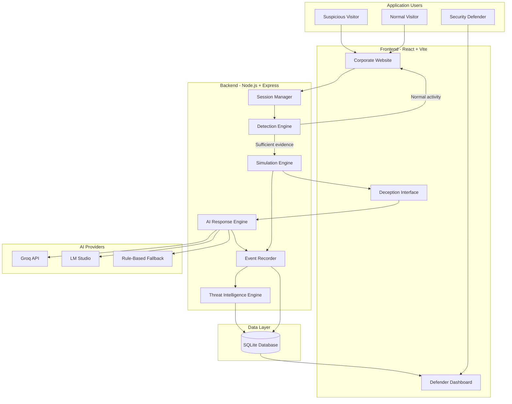
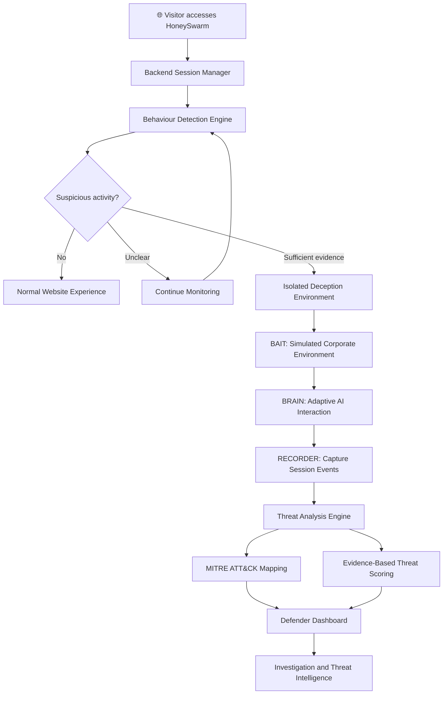
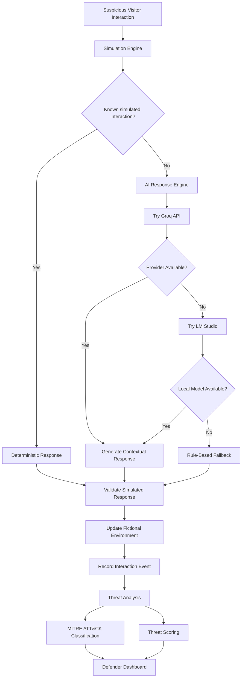

# 🍯 HoneySwarm
### Let Them In. Learn Everything.

**An AI-powered adaptive cyber deception and threat intelligence platform.**

HoneySwarm is a cybersecurity platform that explores a different approach to threat detection: instead of simply identifying and blocking suspicious activity, it uses adaptive cyber deception to understand what suspicious actors attempt to do.

When a visitor demonstrates sufficiently suspicious behaviour, HoneySwarm can route the session into an isolated, fictional corporate environment. There, the visitor can interact with simulated applications, files, accounts, and system interfaces while the platform records activity and transforms observed behaviour into actionable threat intelligence.

**Detect the behaviour. Deceive the attacker. Understand the threat.**

---

## 🎯 1. Problem Statement

Traditional cybersecurity systems primarily focus on detecting, blocking, and preventing malicious activity. However, identifying an attack does not necessarily reveal an attacker's intentions, techniques, objectives, or next moves.

Conventional honeypots provide visibility into attacker behaviour, but static environments often fail to adapt to evolving techniques, limiting meaningful engagement and intelligence collection.

Organizations need a smarter deception approach that can safely engage suspicious actors, study their behaviour, and transform their interactions into actionable threat intelligence without exposing legitimate users or real infrastructure.

## 💡 2. Our Solution

HoneySwarm introduces an AI-assisted adaptive deception platform that combines behavioural detection, simulated environments, contextual AI interactions, and centralized threat monitoring.

The platform follows three core principles:

| Principle | What it does |
|---|---|
| 🔍 **Detect** | Identifies suspicious activity through behavioural analysis and deterministic detection rules. |
| 🎭 **Deceive** | Provides suspicious sessions with a convincing, isolated fictional corporate environment. |
| 🧠 **Learn** | Records interactions, classifies observed techniques, and presents threat intelligence through a defender dashboard. |

The objective is to go beyond detecting suspicious activity and gain insight into what happens after a potential threat is identified.

## 🏗️ 3. Core Architecture

HoneySwarm is organized around three major components.

### 🎭 BAIT — The Deception Environment

BAIT provides the simulated corporate environment in which suspicious visitors can interact.

Simulated resources include:

- Employee portals and internal dashboards.
- Fictional employee directories and accounts.
- Simulated cloud storage and confidential documents.
- Fake administrative panels and permissions.
- Internal communications and announcements.
- A simulated terminal and fictional filesystem.

The environment is designed to resemble an ordinary corporate application rather than an obvious honeypot.

### 🧠 BRAIN — The Adaptive AI Engine

BRAIN provides contextual intelligence for interactions within the simulated environment.

Its responsibilities include:

- Interpreting unexpected visitor interactions.
- Generating context-aware simulated responses.
- Maintaining consistency with the fictional environment.
- Supporting adaptive interactions rather than relying exclusively on static responses.
- Falling back to deterministic responses when an AI provider is unavailable.

AI-generated responses are constrained to the simulation. They must not execute commands on the host operating system or access real infrastructure.

### 📊 RECORDER — The Threat Intelligence Engine

RECORDER observes and analyzes activity within the deception environment.

Its responsibilities include:

- Recording session events and interaction history.
- Identifying suspicious behaviour patterns.
- Mapping supported observations to MITRE ATT&CK techniques.
- Generating evidence-based threat scores.
- Providing session timelines and investigation data.
- Presenting threat intelligence through the defender dashboard.

MITRE ATT&CK classifications should be supported by recorded evidence rather than unsupported assumptions.

### System Architecture Flow



## ⚙️ 4. How HoneySwarm Works

HoneySwarm follows a progressive detection and deception workflow.

1. A visitor accesses the application.
2. The backend monitors relevant session behaviour.
3. The detection engine evaluates activity using predefined rules and behavioural indicators.
4. If suspicious evidence is insufficient, the session continues to be monitored.
5. When sufficient evidence is available, the backend can route the suspicious session into an isolated deception environment.
6. The visitor interacts with simulated corporate resources.
7. The AI engine provides contextual responses where appropriate.
8. RECORDER captures interactions and relevant events.
9. The threat intelligence engine analyzes supported behaviour and identifies relevant techniques.
10. Defenders inspect sessions, timelines, and intelligence through the monitoring dashboard.

### End-to-End Workflow



**Important:** A single unusual request should not automatically trigger deception. Routing decisions should be evidence-based and controlled by backend detection logic.

## 🛠️ 5. Technology Stack

| Layer | Technologies | Purpose |
|---|---|---|
| Frontend | React, Vite | User interface and application development |
| Styling | Tailwind CSS, shadcn/ui | Responsive design and reusable components |
| UI Libraries | Lucide React, Framer Motion | Icons and animations |
| Visualization | Recharts | Threat intelligence and activity charts |
| Navigation | React Router | Application routing |
| Backend | Node.js, Express.js | Server-side logic and REST APIs |
| Real-time Communication | Socket.IO | Live events and dashboard updates |
| Database | SQLite | Application and event data storage |
| Cloud AI | Groq API | Cloud-based AI model access |
| Local AI | LM Studio | Local model integration |
| AI Models | Qwen models | Contextual simulated interactions, where configured |
| Threat Intelligence | MITRE ATT&CK | Adversary technique classification |
| Version Control | Git, GitHub | Source control and collaboration |

## 🔐 6. Security and Isolation

Security is a fundamental requirement of the HoneySwarm architecture.

The deception environment is intended to remain separate from real application infrastructure.

Key security considerations include:

- Backend-controlled session routing and authorization.
- Isolated simulated state for individual visitor sessions.
- No execution of attacker-supplied commands on the host system.
- No access to real production files, accounts, or infrastructure from the simulation engine.
- Validation of AI-generated content before it can affect simulated state.
- Event recording independent of successful AI responses.
- Deterministic simulation behaviour when AI providers are unavailable.
- Environment variables for API keys and other secrets.
- Exclusion of sensitive configuration files from version control.

HoneySwarm is intended for authorized security research, controlled demonstrations, and defensive cybersecurity experimentation.

## 🕵️ 7. Threat Intelligence — MITRE ATT&CK

HoneySwarm uses the MITRE ATT&CK framework as a reference for classifying observed adversarial behaviour.

Examples of techniques that may be identified when supported by evidence include:

| Technique ID | Technique | Example Observation |
|---|---|---|
| T1087 | Account Discovery | Attempts to enumerate simulated accounts |
| T1083 | File and Directory Discovery | Attempts to explore simulated files |
| T1082 | System Information Discovery | Requests for simulated system information |
| T1057 | Process Discovery | Attempts to inspect simulated processes |
| T1016 | System Network Configuration Discovery | Requests for simulated network configuration |

Technique classifications should include supporting event evidence and confidence information.

A generic command or request should not automatically be treated as proof of a more advanced attack.

## 📊 8. Defender Dashboard

The defender interface provides centralized visibility into suspicious sessions and collected intelligence.

Its intended monitoring capabilities include:

- Security overview and activity metrics.
- Active and historical sessions.
- Live event monitoring.
- Session activity timelines.
- Suspicious behaviour classification.
- MITRE ATT&CK technique mapping.
- Evidence-based threat scoring.
- Investigation of individual sessions.
- AI-assisted incident summaries.
- Exportable investigation reports.

Dashboard statistics and visualizations should be derived from recorded application events rather than fabricated demonstration data.

## 🤖 9. AI Integration and Reliability

HoneySwarm uses a hybrid approach combining deterministic logic and AI-assisted interactions.

- **Groq API:** Cloud-based AI model integration through the configured provider.
- **LM Studio:** Local model integration through an OpenAI-compatible API.
- **Rule-based fallback:** Provides deterministic responses for known interactions and basic simulated commands when AI services are unavailable.

### AI Interaction Workflow



The AI engine improves contextual interactions but does not make authoritative security decisions. Detection, session routing, event recording, and access control remain backend responsibilities.

## 📌 10. Project Scope and Limitations

HoneySwarm is developed as a controlled cybersecurity prototype.

Its simulated applications, accounts, documents, terminal, and internal network representations are fictional. It is not intended to provide access to real corporate systems or execute real attacker commands.

The accuracy of threat classifications depends on available observations and detection rules. AI-generated interpretations may require human review.

The prototype should not be considered a replacement for production intrusion detection, endpoint protection, network monitoring, or incident response systems.

Production deployment would require additional security testing, privacy review, scalability work, monitoring, and operational safeguards.

## 🚀 11. Getting Started

### Prerequisites

- Node.js and npm.
- Git.
- A supported web browser.
- A configured AI provider or local LM Studio instance, if AI functionality is enabled.

### Clone the Repository

```bash
git clone https://github.com/0xBrutal/HoneySwarm.git
cd HoneySwarm
```

### Install Dependencies

Install the frontend dependencies:

```bash
cd frontend
npm install
```

Install the backend dependencies:

```bash
cd ../backend
npm install
```

### Configure Environment Variables

Create the required `.env` file inside the backend directory according to the application's environment configuration.

Example configuration:

```env
# Backend
PORT=5000
DATABASE_PATH=./data/honeyswarm.db
SESSION_SECRET=replace_with_a_secure_random_secret
FRONTEND_URL=http://localhost:5173

# AI Provider
AI_PROVIDER=groq
GROQ_API_KEY=YOUR_API_KEY
GROQ_MODEL=MODEL_NAME
GROQ_BASE_URL=https://api.groq.com/openai/v1

# Local AI
LM_STUDIO_BASE_URL=http://localhost:1234/v1
LM_STUDIO_MODEL=
LM_STUDIO_API_KEY=

# Authentication
JWT_SECRET=replace_with_a_secure_random_secret
```

Use the actual variable names defined by the application configuration. Never commit real API keys or secrets.

### Run the Application

Start the backend and frontend using the development scripts defined in their respective `package.json` files.

Refer to the project configuration for the exact startup commands and required settings.

## 🔮 12. Future Scope

Potential improvements include:

- More advanced behavioural detection and anomaly analysis.
- Additional simulated corporate applications and services.
- Improved multi-session correlation.
- Expanded MITRE ATT&CK coverage.
- More sophisticated AI-driven deception strategies.
- Enhanced threat visualization and investigation workflows.
- Scalable deployment and centralized management.
- Additional reporting and security integrations.

## 🌟 13. Project Vision

HoneySwarm explores a different approach to cybersecurity.

Instead of focusing exclusively on keeping attackers out, it investigates how controlled deception can reveal what suspicious actors attempt to do, what resources they seek, and which techniques they demonstrate.

**Traditional security asks: How do we stop the attacker?**

**HoneySwarm asks: What can we learn when suspicious activity enters a controlled environment?**

---

### 🍯 HoneySwarm
**Let Them In. Learn Everything.**
