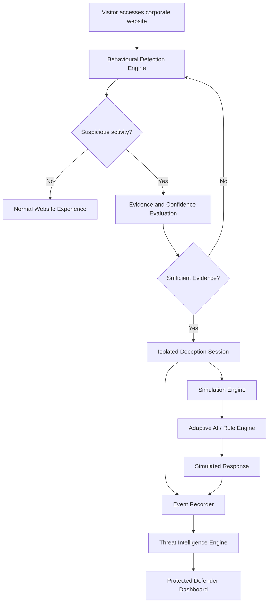

# 🍯 HoneySwarm
### Let Them In. Learn Everything.

**An AI-powered adaptive cyber deception platform that transforms suspicious interactions into actionable threat intelligence.**

<p align="center">
  <strong>Observe · Deceive · Analyze · Learn</strong>
</p>a# 🍯 HoneySwarm
### *Let Them In. Learn Everything.*

**HoneySwarm** is an AI-powered adaptive cyber deception platform. Instead of simply blocking attackers or relying on static, easily-fingerprinted honeypots, HoneySwarm safely engages them in a highly realistic, isolated corporate environment. It studies their behavior, maps their actions to the **MITRE ATT&CK framework** in real-time, and generates actionable threat intelligence for security teams.

> 🏆 **Hackathon Track:** Open Innovation — AI-Powered Cybersecurity & Adaptive Deception

---

## 🛑 The Problem
Traditional cybersecurity focuses on building higher walls. But when an attacker inevitably bypasses the perimeter, defenders learn nothing about their motives, tools, or next moves. Conventional honeypots attempt to solve this, but they are **static**. Attackers can fingerprint them in seconds, rendering them useless. If you just block an attacker, you lose the opportunity to study them.

## 💡 The Solution
HoneySwarm doesn't just block; it **engages**. It dynamically generates a fictional corporate environment ("Vertex Dynamics") that adapts to the attacker's actions. 

### The Three Pillars of HoneySwarm:
1. **The BAIT:** A fully simulated, isolated Linux environment, corporate intranet, cloud drive, and HR chatbot. It contains planted "canary" credentials and synthetic sensitive data.
2. **The BRAIN:** A hybrid AI engine. It uses deterministic rules for standard commands (ensuring zero latency and perfect consistency) and routes unknown, complex commands to an LLM (Groq) to dynamically hallucinate plausible outputs, keeping the attacker trapped in the illusion.
3. **The RECORDER:** An independent monitoring system that logs every keystroke, calculates deterministic threat scores, and maps techniques to MITRE ATT&CK in real-time via WebSockets.

---

## 🏗️ Architecture & Security Guarantees

### 🛡️ Zero-RCE (Remote Code Execution) Design
HoneySwarm is mathematically incapable of being compromised by the attacker. 
* **No Real Shell:** The terminal is a Node.js string parser, not a bash wrapper. There is no `child_process.exec()` anywhere in the codebase.
* **JSON Filesystem:** The entire "Linux filesystem" is a structured JSON document in memory. 
* **Air-gapped AI:** The LLM can only return text. Our strict JSON-output validator ensures the AI can never modify the simulation state, escalate privileges, or execute commands. Even if an attacker uploads a real zero-day exploit script, it sits harmlessly as a text string in the database.

### 🧠 Hybrid "Deterministic-First" AI Engine
Sending every terminal command to an LLM is slow, expensive, and unpredictable. HoneySwarm uses a hybrid approach:
* **Known Commands** (`ls`, `cat`, `whoami`, `su`, `sudo`): Handled instantly by the deterministic engine to ensure the environment remains consistent and stateful.
* **Unknown Commands** (`python exploit.py`, `nmap`, `curl`): Flagged and routed to Groq. The AI hallucinates a highly plausible, context-aware error or output (e.g., `Traceback: ModuleNotFoundError`), maintaining the illusion of a real server without wasting API tokens.

### 🔀 Transparent Routing (Production Vision)
*In this MVP, we use a direct `/portal` link to reliably trigger the deception environment for demonstration purposes.* 
In a production deployment, HoneySwarm sits behind a Reverse Proxy/WAF. Normal users are routed to the real corporate backend. The moment a user exhibits suspicious probing (SQLi, directory busting), the WAF silently flips their session to `deception`, transparently routing them into the honeypot without them ever knowing.

---

## 🛠️ Tech Stack

* **Frontend:** React, Vite, Tailwind CSS, React Router, Socket.IO Client, Recharts
* **Backend:** Node.js, Express, Socket.IO
* **Database:** SQLite (`better-sqlite3` for synchronous, high-performance state)
* **AI Providers:** Groq API (Primary), LM Studio (Secondary), Deterministic Rules (Fallback)
* **Reporting:** PDFKit

---

## 🚀 Getting Started

### Prerequisites
* Node.js v18+ installed
* A free Groq API key (get one at [console.groq.com](https://console.groq.com))

### 1. Clone & Install
```bash
# Clone the repository
git clone <your-repo-url>
cd HoneySwarm

# Install Backend dependencies
cd backend && npm install

# Install Frontend dependencies
cd ../frontend && npm install

---

## Overview

Traditional cybersecurity systems focus on detecting, blocking, and preventing malicious activity. However, identifying suspicious behaviour does not always reveal an attacker's intentions, techniques, objectives, or next moves.

HoneySwarm explores a different approach: **instead of simply blocking suspicious actors, engage them in a controlled deceptive environment and learn from their behaviour.**

HoneySwarm is an AI-powered adaptive cyber deception platform that combines behavioural detection, isolated simulated environments, contextual AI responses, and centralized threat intelligence.

When a session exhibits sufficient suspicious behaviour, the system can assign it to a fictional corporate environment where interactions are simulated and monitored. Defenders can investigate activity through a dedicated dashboard and examine the resulting intelligence.

## Core Components

### 🍯 1. BAIT — Adaptive Deception Environment

A realistic fictional corporate environment designed to engage suspicious visitors.

Planned simulated resources include:

- Employee portals and directories.
- Internal company applications.
- Simulated cloud storage.
- Fictional confidential documents.
- Administrative dashboards.
- Simulated terminals and filesystems.
- Internal communication systems.

The environment maintains isolated session state and responds to interactions without exposing real infrastructure.

### 🧠 2. BRAIN — Adaptive AI Engine

A hybrid response engine combining deterministic simulation rules with contextual AI.

Capabilities include:

- Context-aware simulated responses.
- Adaptive interaction handling.
- Session-aware conversation context.
- Fictional resource discovery.
- Simulated permission and state changes.
- AI-assisted handling of unexpected interactions.
- Deterministic fallback when AI providers are unavailable.

Planned provider priority:

1. OpenRouter.
2. LM Studio.
3. Deterministic rule-based fallback.

AI-generated output is validated before it can influence simulated state. The AI does not execute real commands or access real infrastructure.

### 🔍 3. RECORDER — Threat Intelligence Engine

A monitoring and analysis layer that converts interactions into security intelligence.

Planned capabilities:

- Security event recording.
- Session timelines.
- Behavioural analysis.
- MITRE ATT&CK technique mapping.
- Evidence-based threat scoring.
- Attacker objective estimation.
- Session investigation.
- AI-generated incident summaries.
- Exportable reports.

Observed events, deterministic classifications, estimates and AI-generated interpretations are kept distinguishable.

---

## How It Works



## Key Features

The following represents the intended MVP scope. Individual features should be marked as implemented only after verification.

| Feature | Purpose |
|---|---|
| Behavioural detection | Identify suspicious interaction patterns |
| Progressive deception | Escalate from observation to controlled deception |
| Session isolation | Keep simulated attacker environments independent |
| Adaptive AI responses | Generate contextual simulated interactions |
| Rule-based fallback | Maintain functionality without an AI provider |
| Event recording | Preserve security-relevant activity |
| MITRE ATT&CK mapping | Associate supported behaviours with techniques |
| Threat scoring | Quantify observed suspicious activity |
| Live monitoring | Display active sessions and events |
| Incident reporting | Generate investigation reports |
| Automated attack scenario | Demonstrate the attack-to-intelligence workflow |

## Technology Stack

The planned technology stack includes:

| Layer | Technologies |
|---|---|
| Frontend | React, Vite |
| Styling | Tailwind CSS, shadcn/ui |
| Backend | Node.js, Express |
| Database | SQLite |
| Realtime communication | Socket.IO |
| Visualization | Recharts |
| Animation | Framer Motion |
| AI integration | OpenRouter, LM Studio |
| Threat classification | Rule-based MITRE ATT&CK mapping |

## Architecture

HoneySwarm is designed as a modular full-stack application.

Core backend modules:

- `session-manager`
- `detection-engine`
- `simulation-engine`
- `ai-response-engine`
- `event-recorder`
- `threat-classifier`
- `dashboard-service`

The frontend provides separate experiences for public visitors, simulated attacker sessions, and authorized defenders.

The backend is responsible for session routing, authorization, isolation, event recording and simulation state.

## Getting Started

> **Development status:** Setup instructions will be finalized and verified as the MVP implementation is completed.

### Prerequisites

- Node.js (LTS recommended).
- npm.
- Git.
- An OpenRouter API key for cloud AI, or LM Studio for local AI.

### Clone the repository

```bash
git clone https://github.com/YOUR-USERNAME/HoneySwarm.git
cd HoneySwarm
```

### Install dependencies

Once the frontend and backend packages are available:

```bash
cd frontend
npm install

cd ../backend
npm install
```

### Configure environment variables

Create `.env` files according to the provided environment examples.

Example backend configuration:

```env
# Backend
PORT=5000
DATABASE_PATH=./data/honeyswarm.db
SESSION_SECRET=super_secret_honeyswarm_key_change_me
FRONTEND_URL=http://localhost:5173

# AI Providers
AI_PROVIDER=groq
GROQ_API_KEY=API_KEY
GROQ_MODEL=MODEL_NAME_CHANGE_ME
GROQ_BASE_URL=https://api.groq.com/openai/v1

LM_STUDIO_BASE_URL=http://localhost:1234/v1
LM_STUDIO_MODEL=
LM_STUDIO_API_KEY=

JWT_SECRET=super_secret_honeyswarm_key_change_me
```

Never commit actual API keys, passwords or secrets.

### Run the application

The exact development commands will be documented after the project scripts are finalized.

## Security and Privacy

HoneySwarm is designed as a defensive cybersecurity research and demonstration platform.

Security principles:

- Fictional credentials and company data.
- Isolated simulated environments.
- No real shell execution.
- No unauthorized access to production infrastructure.
- Backend-protected defender endpoints.
- Validated AI-generated responses.
- Privacy-conscious security event collection.
- No unnecessary collection of personal information.

**HoneySwarm must not be deployed to intercept real users or production traffic without proper authorization, security review, privacy safeguards and operational testing.**

## Project Status

HoneySwarm is being developed as a hackathon MVP.

Planned development priorities:

1. Application foundation and authentication.
2. Public corporate website.
3. Isolated deception environment.
4. Detection and event recording.
5. Adaptive AI integration.
6. Defender dashboard.
7. Automated attack demonstration.
8. Incident reporting and integration testing.

Features should be updated here as they become implemented and verified.

## Roadmap

### Phase 1 — MVP
- Functional corporate website.
- Behavioural detection.
- Isolated simulated environment.
- Adaptive AI with fallback.
- Event recording.
- Defender dashboard.

### Phase 2 — Enhanced Intelligence
- Expanded MITRE ATT&CK mapping.
- Richer threat analysis.
- Advanced session investigation.
- Improved incident reporting.
- Multi-session correlation.

### Phase 3 — Advanced Deception Platform
- More sophisticated simulated environments.
- Expanded security integrations.
- Improved behavioural intelligence.
- Advanced deception strategies.

## Contributing

Contributions, ideas and technical feedback are welcome.

Before submitting changes:

1. Check existing issues and project requirements.
2. Keep changes focused.
3. Test the affected functionality.
4. Document new configuration requirements.
5. Avoid introducing real credentials or sensitive information.

## Disclaimer

HoneySwarm is intended for authorized defensive cybersecurity research, controlled demonstrations, education and experimentation.

It is not intended to facilitate unauthorized access, exploitation, credential theft or malicious activity.

Use the platform only in environments you own or have explicit authorization to test.

## License

This project is licensed under the Apache License 2.0.

See the [LICENSE](LICENSE) file for details.

---

**HoneySwarm — Let Them In. Learn Everything.**
